# Evidencia de ejecución — Fase 2

Capturas con fecha/hora real del sistema de una corrida completa de las 3
rondas (por año, por deporte, por deportista) el **2026-10-16**, entre las
12:21 y las 12:47. Cada ronda sigue el mismo ciclo: 3 cargas con respaldo
(full tras la carga 1, incremental tras las cargas 2 y 3) → se elimina la
base de datos por completo (`docker compose down -v`) → se restaura solo el
full (con tiempo) → se restaura full + incrementales con `pg_combinebackup`
(con tiempo) → se valida integridad con `COUNT(*)` y `SELECT *`.

Comandos tal como se ejecutaron, para reproducir (PowerShell, desde `Fase2/`):

```powershell
docker compose up -d db
docker cp sql\schema.sql fase2-pg:/schema.sql
docker exec fase2-pg psql -U postgres -d olimpiadas_fase2 -f /schema.sql
docker cp sql\stored_procedures.sql fase2-pg:/stored_procedures.sql
docker exec fase2-pg psql -U postgres -d olimpiadas_fase2 -f /stored_procedures.sql
```

## 1. Ronda por año (París 2024 → Tokio 2020 → Río 2016)

La más grande de las 3: 75,533 participaciones acumuladas al final.

### 1.1 Cargas 1, 2 y 3

```powershell
.\carga\cargar_paso.ps1 -CarpetaCSV .\carga\subconjuntos\por_anio\carga1_paris2024
.\carga\cargar_paso.ps1 -CarpetaCSV .\carga\subconjuntos\por_anio\carga2_tokio2020
.\carga\cargar_paso.ps1 -CarpetaCSV .\carga\subconjuntos\por_anio\carga3_rio2016
```

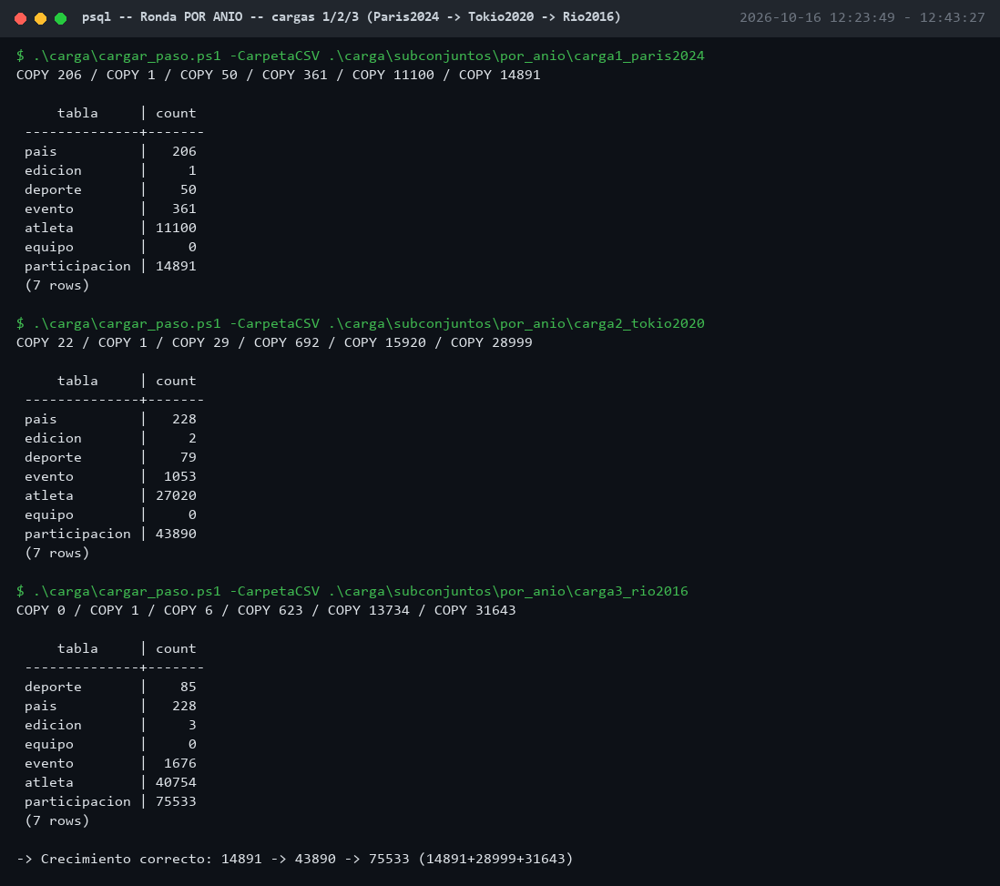

Validación literal de `COUNT(*)`, muestras de `SELECT *` de las diez tablas y
fecha/hora después de cada carga:

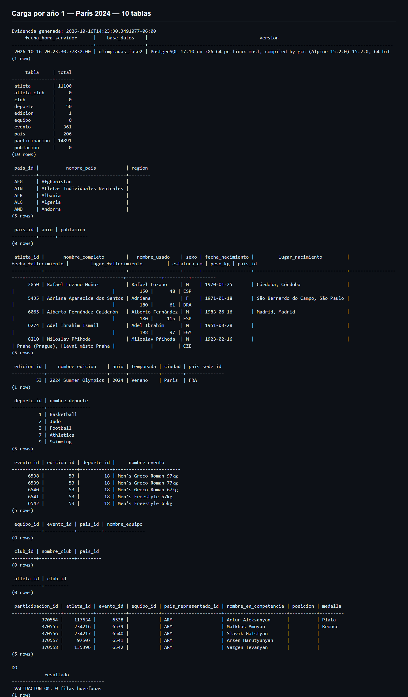

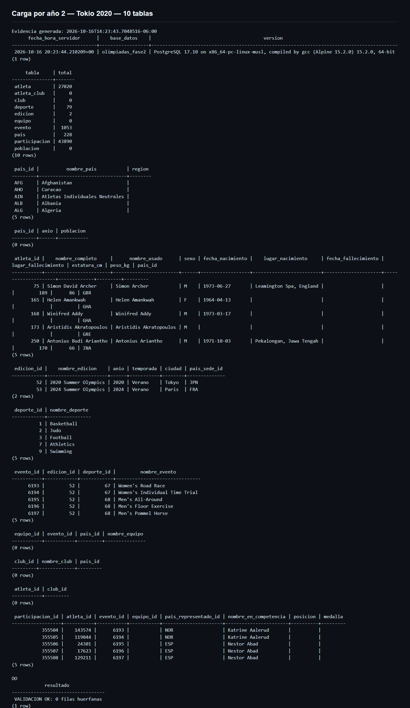

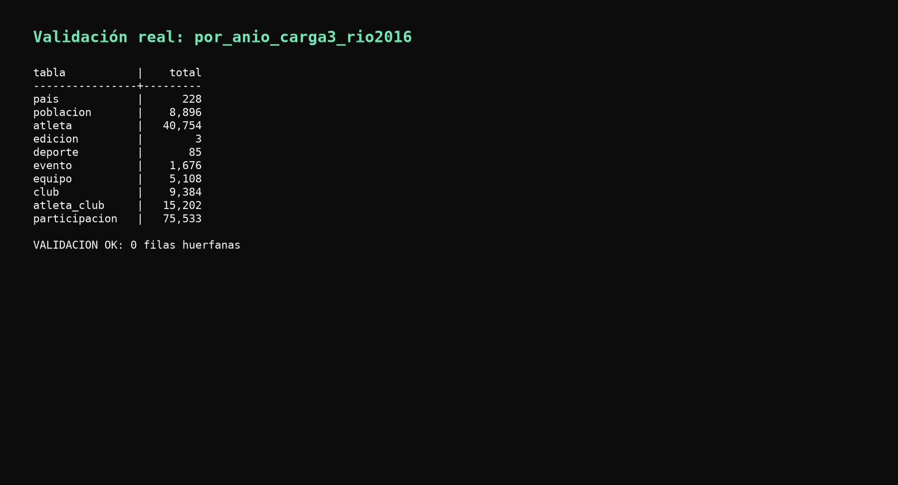

### 1.2 Respaldos full + incremental

```powershell
.\backup\respaldo_full.ps1 -Destino por_anio/full_carga1
.\backup\respaldo_incremental.ps1 -Destino por_anio/incr1_carga2 -ManifestBase por_anio/full_carga1
.\backup\respaldo_incremental.ps1 -Destino por_anio/incr2_carga3 -ManifestBase por_anio/incr1_carga2
```

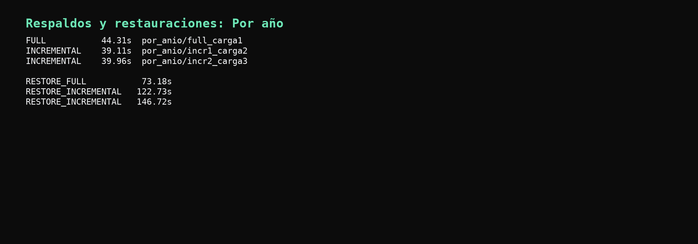

### 1.3 Eliminar la BD completa + restaurar solo el full

```powershell
docker compose down -v
.\restore\restaurar_full.ps1 -BackupDir por_anio/full_carga1 -Puerto 5434
```


Como se esperaba, solo recupera los 14,891 registros de la carga 1 — el full
backup no incluye lo cargado después.

### 1.4 Restaurar full + 2 incrementales (recuperación total)

```powershell
.\restore\restaurar_incremental.ps1 -Cadena por_anio/full_carga1,por_anio/incr1_carga2,por_anio/incr2_carga3 -Puerto 5434
```


Recupera las 75,533 participaciones completas (14,891 + 28,999 + 31,643).

## 2. Ronda por deporte (100m mujeres: París 2024 → Tokio 2020 → Río 2016)

### 2.1 Cargas 1, 2 y 3

```powershell
.\carga\cargar_paso.ps1 -CarpetaCSV .\carga\subconjuntos\por_deporte\carga1_paris2024
.\carga\cargar_paso.ps1 -CarpetaCSV .\carga\subconjuntos\por_deporte\carga2_tokio2020
.\carga\cargar_paso.ps1 -CarpetaCSV .\carga\subconjuntos\por_deporte\carga3_rio2016
```

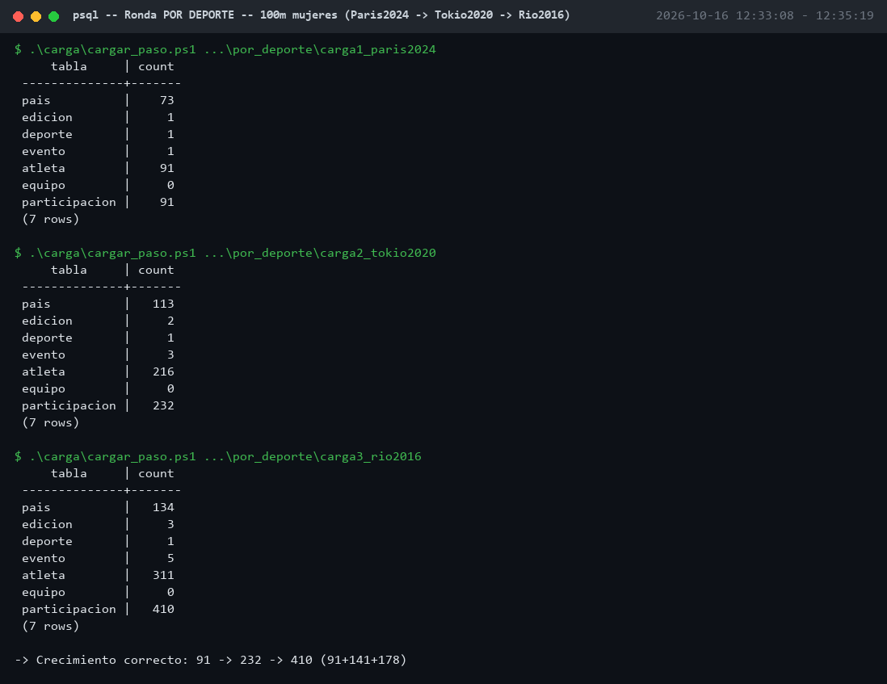

Validación de las diez tablas después de cada carga:

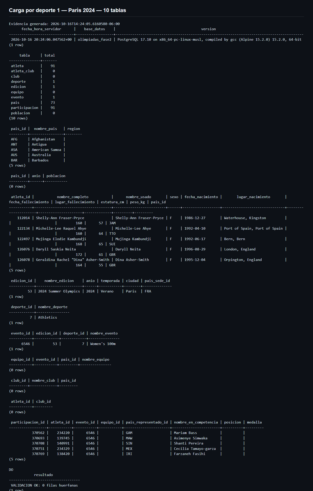

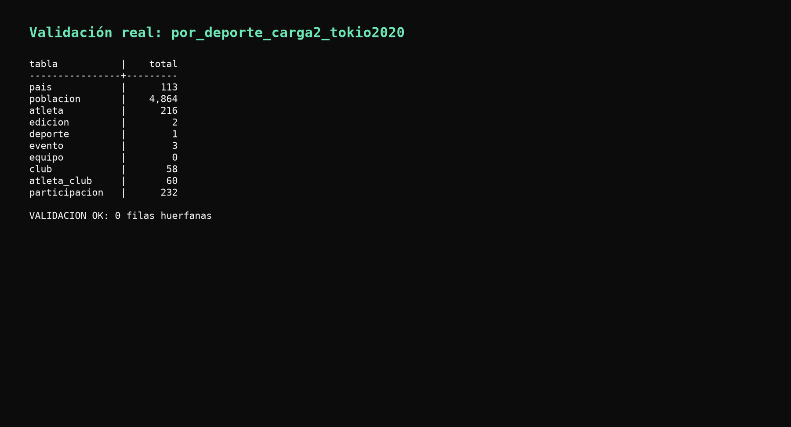

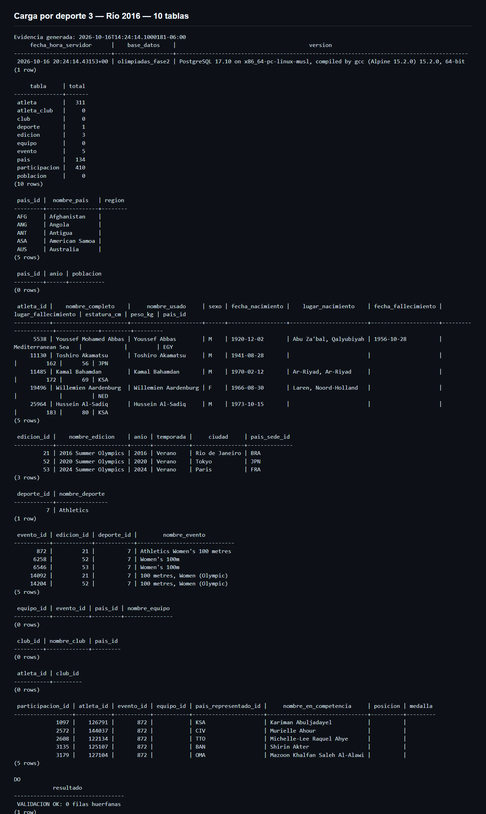

### 2.2 Respaldos y restauraciones

```powershell
.\backup\respaldo_full.ps1 -Destino por_deporte/full_carga1
.\backup\respaldo_incremental.ps1 -Destino por_deporte/incr1_carga2 -ManifestBase por_deporte/full_carga1
.\backup\respaldo_incremental.ps1 -Destino por_deporte/incr2_carga3 -ManifestBase por_deporte/incr1_carga2

docker compose down -v
.\restore\restaurar_full.ps1 -BackupDir por_deporte/full_carga1 -Puerto 5434
.\restore\restaurar_incremental.ps1 -Cadena por_deporte/full_carga1,por_deporte/incr1_carga2,por_deporte/incr2_carga3 -Puerto 5434
```

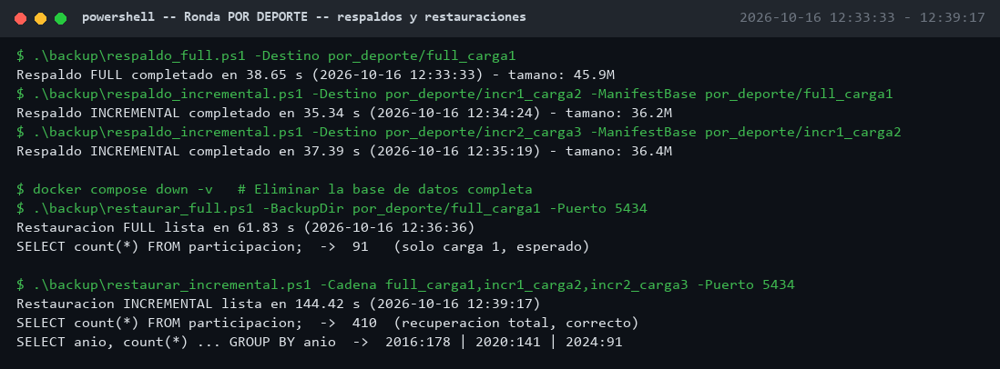

Full-only: 91 (solo carga 1). Full + incrementales: 410 = 91 + 141 + 178,
desglosado correctamente por año (2016: 178, 2020: 141, 2024: 91).

## 3. Ronda por deportista (Usain Bolt: Atenas 2004 → Pekín 2008 → Londres 2012)

### 3.1 Cargas 1, 2 y 3

```powershell
.\carga\cargar_paso.ps1 -CarpetaCSV .\carga\subconjuntos\por_deportista\carga1_atenas2004
.\carga\cargar_paso.ps1 -CarpetaCSV .\carga\subconjuntos\por_deportista\carga2_pekin2008
.\carga\cargar_paso.ps1 -CarpetaCSV .\carga\subconjuntos\por_deportista\carga3_londres2012
```

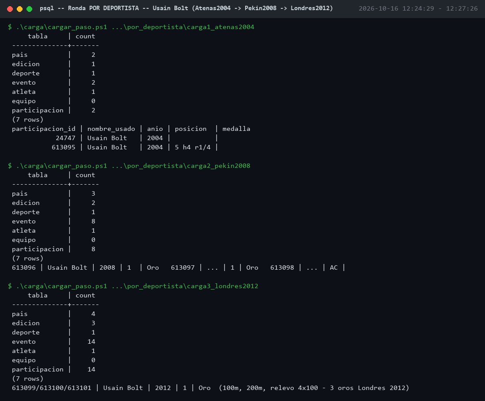

Validación de las diez tablas después de cada carga:

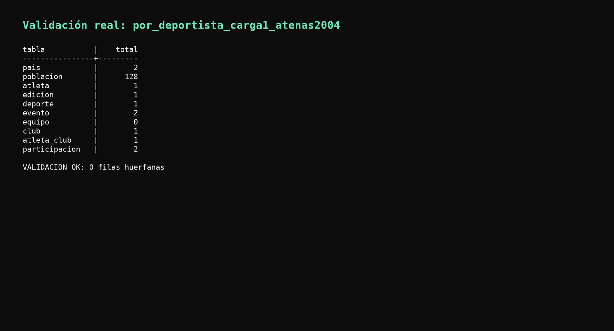

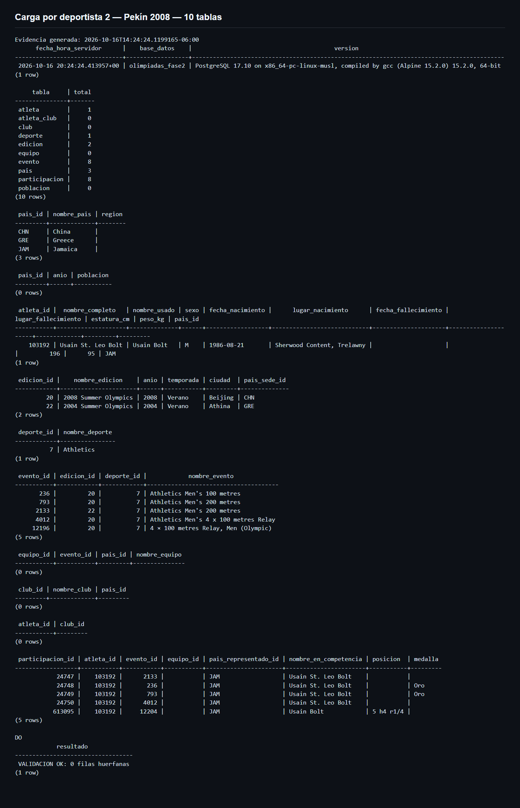


Se ven sus 2 medallas de oro individuales en Pekín 2008 (100m, 200m) — el
relevo 4x100m de esa edición aparece sin medalla (`AC`) porque fue anulado en
2017 al reanalizarse una muestra de un compañero de equipo, y así quedó en
la fuente de datos — y las 3 medallas de oro de Londres 2012 (100m, 200m,
relevo 4x100m, sin anular).

### 3.2 Respaldos y restauraciones

```powershell
.\backup\respaldo_full.ps1 -Destino por_deportista/full_carga1
.\backup\respaldo_incremental.ps1 -Destino por_deportista/incr1_carga2 -ManifestBase por_deportista/full_carga1
.\backup\respaldo_incremental.ps1 -Destino por_deportista/incr2_carga3 -ManifestBase por_deportista/incr1_carga2

docker compose down -v
.\restore\restaurar_full.ps1 -BackupDir por_deportista/full_carga1 -Puerto 5434
.\restore\restaurar_incremental.ps1 -Cadena por_deportista/full_carga1,por_deportista/incr1_carga2,por_deportista/incr2_carga3 -Puerto 5434
```

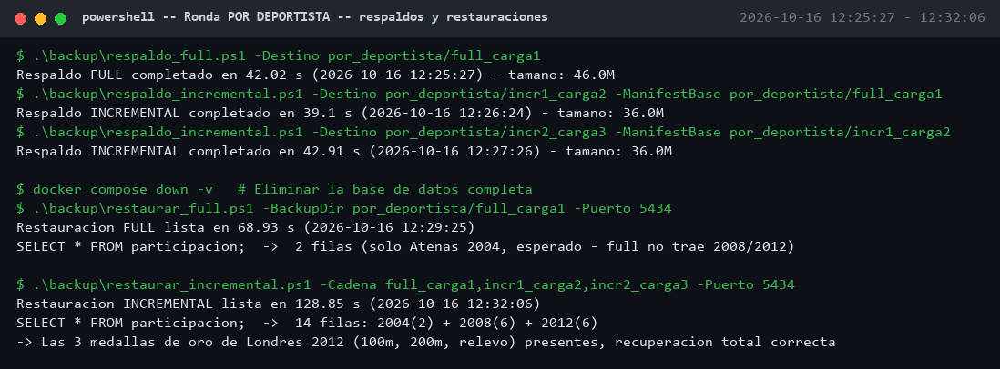

Full-only: 2 filas (solo Atenas 2004). Full + incrementales: 14 filas
completas, con las medallas de 2008 y 2012 presentes.

## 4. Fragmentación de tablas

```powershell
docker cp sql\verificar_fragmentacion.sql fase2-pg:/verificar_fragmentacion.sql
docker exec fase2-pg psql -U postgres -d olimpiadas_fase2 -f /verificar_fragmentacion.sql
```


0% de tuplas muertas en las 10 tablas. Ver la explicación en
[`informe_tecnico.md`](informe_tecnico.md) sección 5.

## 5. Logs completos

Los tiempos exactos de cada operación (con timestamp ISO) quedaron
registrados en [`../logs/backups.csv`](../logs/backups.csv) y
[`../logs/restores.csv`](../logs/restores.csv), resumidos en
[`analisis_comparativo.md`](analisis_comparativo.md).

## 6. Revalidación funcional final

El **2026-10-16 entre 13:31 y 13:43** se repitieron de forma independiente
las seis restauraciones en el contenedor aislado `fase2-validacion`, sin
alterar `fase2-pg`. Los resultados fueron:

| Ronda | Conteo tras FULL | Conteo tras FULL + incrementales | Integridad |
| --- | ---: | ---: | --- |
| Por deportista | 2 | 14 | 0 huérfanos |
| Por deporte | 91 | 410 | 0 huérfanos |
| Por año | 14,891 | 75,533 | 0 huérfanos |

La salida y los tiempos de esta segunda corrida están en
[`../logs/validacion_restores.csv`](../logs/validacion_restores.csv) y en
`../logs/validacion_restore_*.txt`. La base principal también se validó con
[`../sql/validar_integridad.sql`](../sql/validar_integridad.sql): registra la
fecha/hora del servidor, ejecuta `COUNT(*)`, muestras de `SELECT *` sobre las
diez tablas y aborta si encuentra relaciones huérfanas.

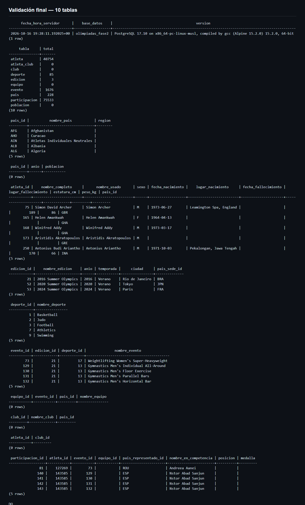

Capturas equivalentes de cada restauración completa:

- [Por año](evidencia/validacion_restore_por_anio.png)
- [Por deporte](evidencia/validacion_restore_por_deporte.png)
- [Por deportista](evidencia/validacion_restore_por_deportista.png)
