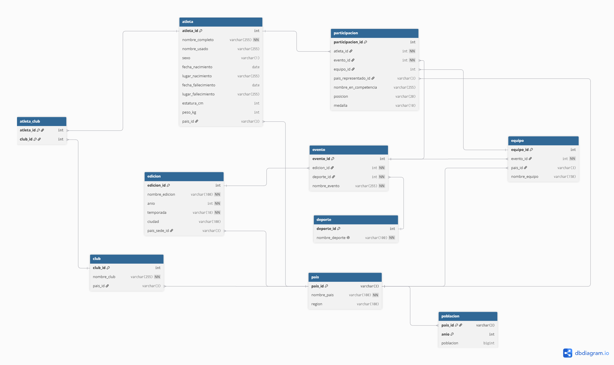
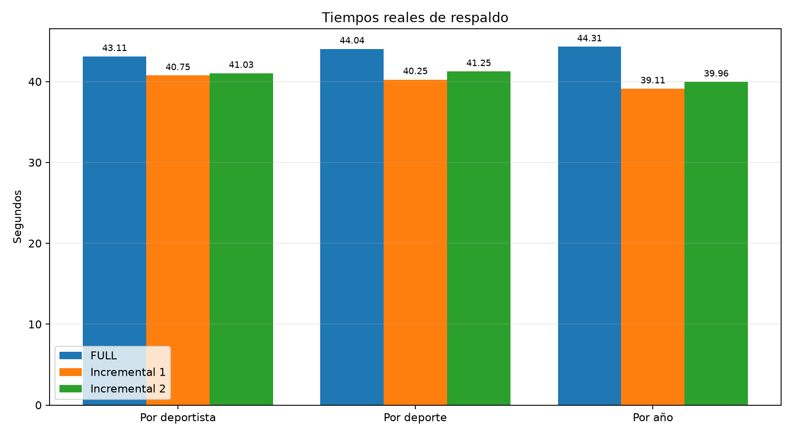
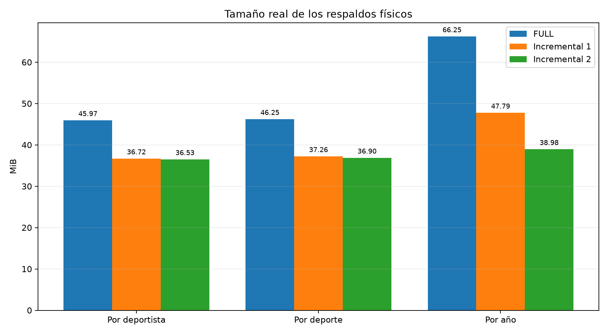
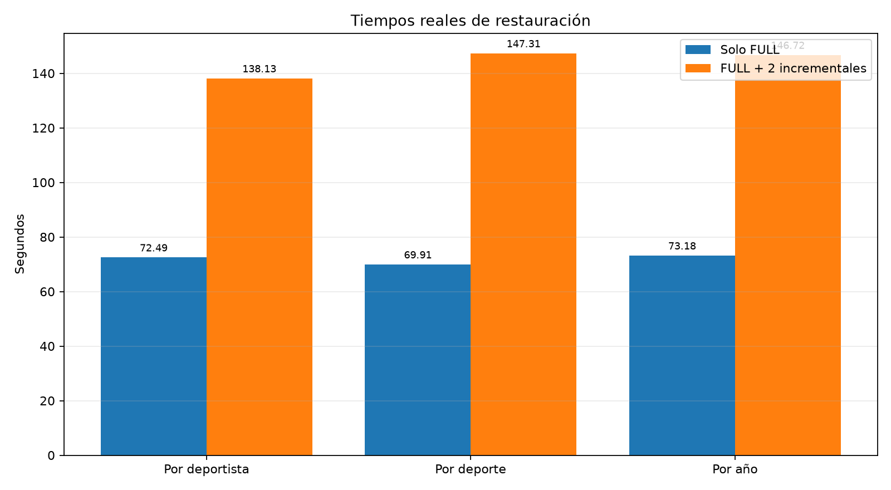

# Informe Técnico — Fase 2: Respaldo y Restauración

Proyecto: [`775_Proyecto_2_2S2026.md`](../../775_Proyecto_2_2S2026.md).
Ejecución documentada: **2026-10-16**.

## 1. Metodología

Se trabajó sobre la base de datos de Olimpiadas de [Fase 1](../../Fase1), con el
mismo modelo entidad-relación (10 tablas, ver sección 2). En vez de repetir el
ETL de las 7 fuentes originales, se generaron subconjuntos a partir de los
CSV ya procesados en `Fase1/etl-csvs/` (ver [`carga/generar_subconjuntos.py`](../carga/generar_subconjuntos.py)),
uno por cada ronda pedida por el enunciado:

| Ronda | Carga 1 | Carga 2 | Carga 3 |
| --- | --- | --- | --- |
| Por año | París 2024 | Tokio 2020 | Río 2016 |
| Por deporte | Atletismo 100m mujeres — París 2024 | ídem — Tokio 2020 | ídem — Río 2016 |
| Por deportista | Usain Bolt — Atenas 2004 | ídem — Pekín 2008 | ídem — Londres 2012 |

Cada paso inserta **solo las filas nuevas** respecto al paso anterior (carga
delta vía `COPY`), para que el crecimiento de la base de datos entre cargas
sea real y el respaldo incremental tenga algo que capturar. Para cada ronda,
en una instancia nueva: carga 1 → respaldo completo → carga 2 → respaldo
incremental → carga 3 → respaldo incremental → se elimina la base de datos
por completo → se restaura solo el full (con tiempo) → se restaura full +
incrementales (con tiempo) → se valida integridad.

## 2. Modelo entidad-relación utilizado

Igual al de Fase 1 (reutilizado sin cambios): `pais`, `poblacion`, `atleta`,
`edicion`, `deporte`, `evento`, `equipo`, `club`, `atleta_club`,
`participacion`. Ver [`../../Fase1/informe.md`](../../Fase1/informe.md)
sección 4 para el diagrama y [`../../Fase1/img/ER.png`](../../Fase1/img/ER.png).



El generador de Fase 2 recorre las relaciones del subconjunto y produce deltas
para `pais`, `poblacion`, `edicion`, `deporte`, `evento`, `atleta`, `club`,
`atleta_club` y `participacion`. En Fase 1, `equipo` se construía después de
importar los CSV mediante `etl/derivar_equipos.sql`; por eso el archivo
`etl-csvs/equipo.csv` no contiene el resultado derivado. Para mantener el
mismo comportamiento, `cargar_paso.ps1` ejecuta
[`sql/derivar_equipos.sql`](../sql/derivar_equipos.sql) después de cada delta,
reconstruye los equipos sobre todas las participaciones acumuladas y vuelve a
enlazar `participacion.equipo_id` antes de validar y respaldar. En el estado
final por año se obtuvieron 5,108 equipos y 28,647 participaciones enlazadas;
los escenarios de 100 metros y un solo deportista conservan cero equipos de
forma correcta porque sus subconjuntos no contienen grupos de dos o más
atletas del mismo país en un evento colectivo.

## 3. Plan de respaldo

**Herramienta:** `pg_basebackup` / `pg_combinebackup` (nativas de PostgreSQL
17, físicas, no dumps). Se descartó `pg_dump` porque el enunciado pide
explícitamente una herramienta de respaldo físico.

**Por qué PostgreSQL 17:** es la primera versión con respaldo incremental
nativo (`pg_basebackup --incremental`). Versiones anteriores (como el
Postgres 16 usado en Fase 1) solo permiten "incremental" vía archivado
continuo de WAL, que es más difícil de operar y de medir por separado.

**Configuración:** `summarize_wal = on` en el servidor (ver
[`docker-compose.yml`](../docker-compose.yml)), que habilita un proceso en
segundo plano que resume los cambios de WAL en archivos de resumen —
`pg_basebackup --incremental` los usa para identificar qué bloques cambiaron
desde el respaldo de referencia.

**Estrategia elegida:** incremental **encadenado** (cada incremental usa como
base el `backup_manifest` del respaldo inmediatamente anterior, no siempre el
del full) — ver `backup/respaldo_incremental.ps1`. Se prefirió sobre
diferencial porque, en teoría, cada incremental solo contiene los bloques
modificados desde el respaldo *inmediato* anterior (más chico cuanto más
seguido se respalda), mientras que un diferencial siempre compara contra el
full y crece con cada carga. No se implementó la variante diferencial para
comparar ambas empíricamente — queda como trabajo futuro; lo que sí se midió
(sección 2 de [`analisis_comparativo.md`](analisis_comparativo.md)) es que
los incrementales pesan aproximadamente 19-41% menos que el full.

**Almacenamiento:** los respaldos se escriben en `./backups` (carpeta del
host, montada en el contenedor), no en el volumen de datos de Postgres —
así sobreviven a un `docker compose down -v` (ver sección 8.3 del enunciado,
"almacenamiento persistente").

## 4. Especificaciones técnicas del servidor

- Motor: PostgreSQL 17.11 (imagen `postgres:17-alpine`), vía Docker Desktop
  en Windows.
- Contenedor principal: `fase2-pg`, puerto 5433 (host) → 5432.
- Volumen de datos: volumen Docker nombrado `fase2_pgdata` (persistente).
- Backups: bind-mount `./backups` del host.
- Restauración de prueba: contenedores efímeros (`fase2-prueba`, puerto
  5544) con `postgres:17-alpine`, sin recursos dedicados adicionales a los
  límites por defecto de Docker Desktop.

## 5. Fragmentación de las tablas

La metodología (sección 6, Fase 2 del enunciado) pide obtener el nivel de
fragmentación de las tablas al final de cada tipo de carga. Se midió con
`pg_stat_user_tables` (tuplas vivas vs. muertas) y la extensión `pgstattuple`
(detalle a nivel de bytes) — ver [`sql/verificar_fragmentacion.sql`](../sql/verificar_fragmentacion.sql):

```powershell
docker cp sql\verificar_fragmentacion.sql fase2-pg:/verificar_fragmentacion.sql
docker exec fase2-pg psql -U postgres -d olimpiadas_fase2 -f /verificar_fragmentacion.sql
```

Las inserciones se realizan con `COPY`, pero después de cada paso la
derivación idempotente actualiza `participacion.equipo_id`, elimina los equipos
anteriores y los reconstruye. Por tanto, `pg_stat_user_tables` puede mostrar
tuplas muertas en `participacion` y `equipo` hasta que `autovacuum` las limpie;
esto es comportamiento MVCC esperado, no pérdida de integridad. La medición
reproducible y el detalle con `pgstattuple` se obtienen con el comando anterior
y se contrastan con la validación de cero filas huérfanas. En la medición final,
las estadísticas estimaron 46,526 tuplas muertas en `participacion` (38.12%) y
3,367 en `equipo` (39.73%); ambas tablas ya registraban una ejecución de
`autovacuum`. La inspección física exacta de `participacion` mediante
`pgstattuple`, realizada inmediatamente después, encontró 0 tuplas muertas y
35.85% de espacio libre, mostrando que la estimación estadística todavía no se
había actualizado después de la limpieza.


## 6. Resultados y análisis comparativo

Ver [`analisis_comparativo.md`](analisis_comparativo.md) (tiempos, tamaños,
hallazgos y recomendación) y [`evidencia.md`](evidencia.md) (capturas con
fecha de cada paso).







## 7. Conclusiones

1. El respaldo físico incremental de Postgres 17 funciona correctamente sin
   herramientas de terceros: se validó end-to-end en 3 rondas distintas
   (24 operaciones de carga/respaldo/restauración en total) sin fallos de
   integridad.
2. A la escala de datos manejada (decenas de miles de filas, decenas de MB),
   el tiempo de respaldo está dominado por el overhead fijo de
   `pg_basebackup` (checkpoint + streaming de WAL), no por el volumen de
   datos — la ventaja del incremental se ve en el **tamaño** en disco, no en
   la velocidad de toma del respaldo.
3. La restauración incremental es consistentemente más lenta que la
   restauración de solo el full (91%-111% más tiempo en las pruebas nuevas), porque
   `pg_combinebackup` debe reconstruir el directorio completo antes de poder
   arrancar el servidor.
4. Restaurar solo el full backup es más rápido pero **incompleto** — en las
   3 rondas, el `COUNT(*)` tras restaurar solo el full coincidió exactamente
   con los datos de la carga 1, confirmando que los incrementales son
   indispensables para una recuperación total.
5. Recomendación: estrategia híbrida full periódico + incrementales
   frecuentes, priorizando RPO bajo (minimizar pérdida de datos) sobre RTO
   (tiempo de restauración), dado que el costo de *tomar* un incremental es
   similar al de un full pero pesa menos en disco.
6. La derivación de equipos reproduce correctamente el paso de Fase 1 y hace
   que las diez tablas participen en la validación. Como emplea `UPDATE` y
   `DELETE`, `autovacuum` sigue siendo necesario para recuperar espacio de
   tuplas muertas; esto no afecta la consistencia de los respaldos físicos.

## 8. Validación final de entrega

Antes de cerrar la entrega se restauraron nuevamente los tres full y las tres
cadenas completas en un contenedor aislado. Los seis conteos coincidieron con
los esperados (2/14 por deportista, 91/410 por deporte y 14,891/75,533 por
año), y `sql/validar_integridad.sql` confirmó cero filas huérfanas en cada
estado final. También se verificó la sintaxis de todos los scripts PowerShell
y Python, los nueve manifiestos físicos y la disponibilidad de `fase2-pg` con
75,533 participaciones. La evidencia reproducible está en `logs/validacion_*`.


