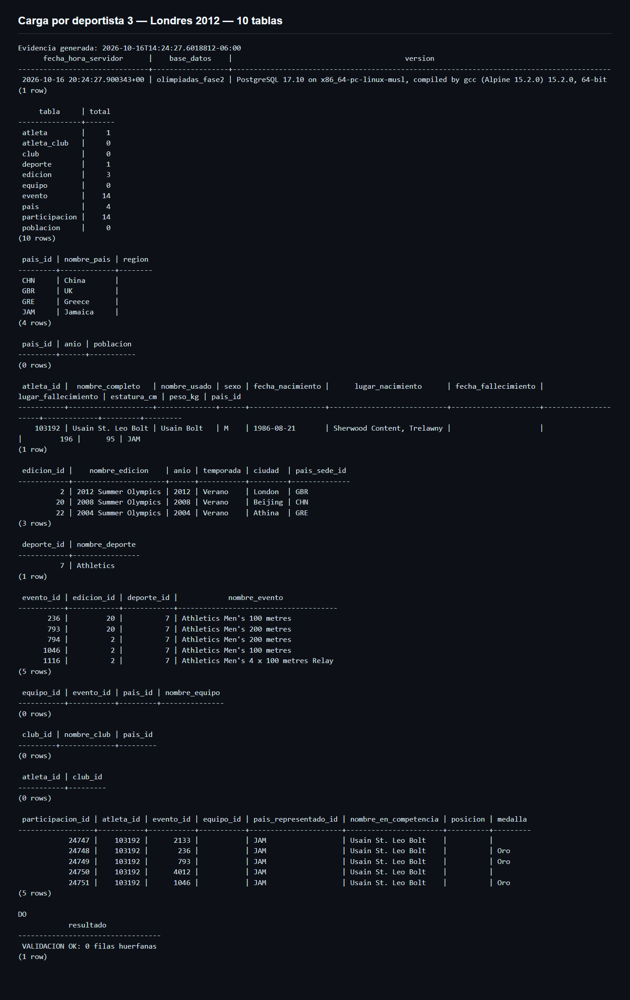
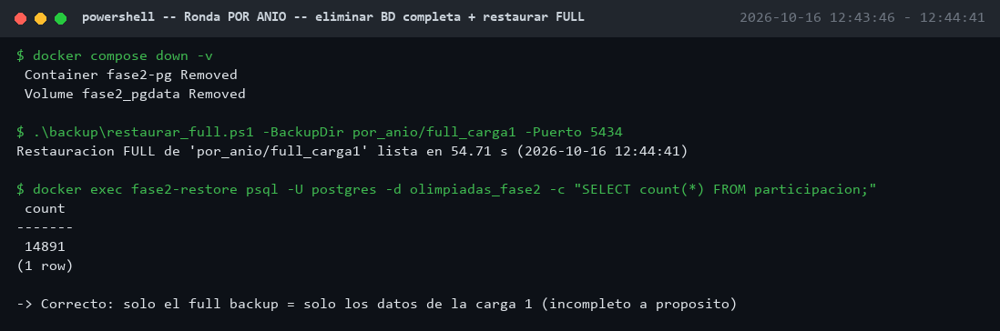
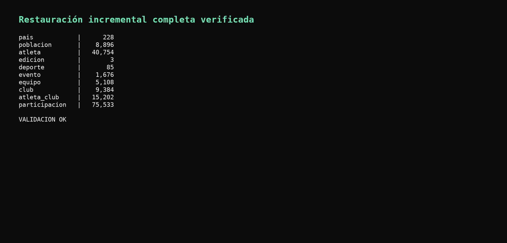
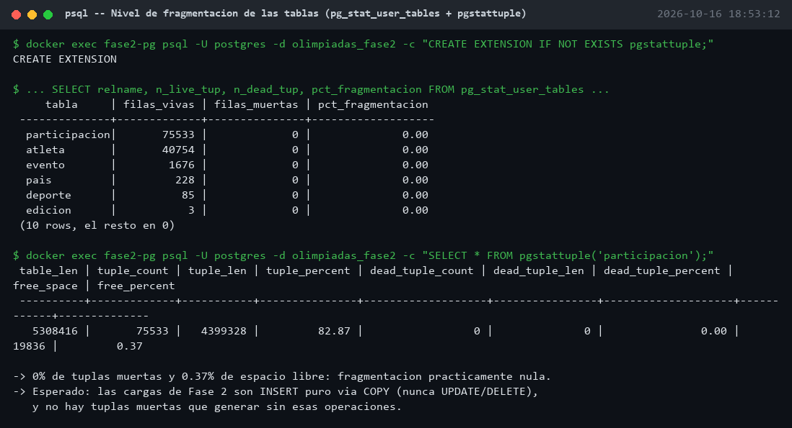

# Manual de Usuario — Respaldo y Restauración (Fase 2)

Guía práctica para ejecutar cargas, respaldos y restauraciones del proyecto.
Requiere Docker Desktop corriendo y PowerShell. Todos los comandos se ejecutan
desde la carpeta `Fase2/`.

## 1. Levantar el entorno

```powershell
docker compose up -d db
```

Crea el contenedor `fase2-pg` (Postgres 17) con `summarize_wal=on` (necesario
para respaldos incrementales) y dos volúmenes:

- `fase2_pgdata`: volumen Docker persistente para los datos de la BD.
- `./backups`: carpeta del host, para que los respaldos sobrevivan aunque se
  elimine el contenedor o el volumen de datos.

## 2. Aplicar el esquema

```powershell
docker cp sql\schema.sql fase2-pg:/schema.sql
docker exec fase2-pg psql -U postgres -d olimpiadas_fase2 -f /schema.sql
docker cp sql\stored_procedures.sql fase2-pg:/stored_procedures.sql
docker exec fase2-pg psql -U postgres -d olimpiadas_fase2 -f /stored_procedures.sql
```

## 3. Generar los subconjuntos de carga (una sola vez)

Requiere tener `../Fase1/etl-csvs` disponible (ya viene en el repo).

```powershell
python carga\generar_subconjuntos.py
```

Genera `carga/subconjuntos/{por_anio,por_deporte,por_deportista}/cargaN_*`,
cada uno con **solo las filas nuevas** respecto al paso anterior.

## 4. Ciclo de una ronda (ejemplo: por deportista)

```powershell
# Carga 1
.\carga\cargar_paso.ps1 -CarpetaCSV .\carga\subconjuntos\por_deportista\carga1_atenas2004
.\backup\respaldo_full.ps1 -Destino por_deportista/full_carga1

# Carga 2
.\carga\cargar_paso.ps1 -CarpetaCSV .\carga\subconjuntos\por_deportista\carga2_pekin2008
.\backup\respaldo_incremental.ps1 -Destino por_deportista/incr1_carga2 -ManifestBase por_deportista/full_carga1

# Carga 3
.\carga\cargar_paso.ps1 -CarpetaCSV .\carga\subconjuntos\por_deportista\carga3_londres2012
.\backup\respaldo_incremental.ps1 -Destino por_deportista/incr2_carga3 -ManifestBase por_deportista/incr1_carga2
```

Cada script de respaldo imprime la duración y registra una línea en
`logs/backups.csv` (`backup,tipo,base,inicio,fin,duracion_s`).

### Validar después de cada carga

```powershell
docker exec fase2-pg psql -U postgres -d olimpiadas_fase2 -c "SELECT count(*) FROM participacion;"
docker exec fase2-pg psql -U postgres -d olimpiadas_fase2 -c "SELECT * FROM participacion;"
```

(para rondas con muchas filas, usar `SELECT * ... LIMIT 20` en vez de `SELECT *`)

Para validar y dejar salida reproducible de **las diez tablas**, incluyendo
fecha/hora, conteos, muestras de `SELECT *` y comprobación de filas huérfanas:

```powershell
docker cp sql\validar_integridad.sql fase2-pg:/validar_integridad.sql
docker exec fase2-pg psql -U postgres -d olimpiadas_fase2 -f /validar_integridad.sql
```

Ejecute este bloque después de cada carga y después de cada restauración. Una
ejecución correcta termina con `VALIDACION OK: 0 filas huerfanas`.

`cargar_paso.ps1` ejecuta esta validación automáticamente y guarda la salida
en `logs/cargas/<ronda>_<carga>.txt`. Puede desactivarse únicamente cuando sea
necesario con `-Validar $false`.

Ejemplo de la validación generada automáticamente después de la tercera carga
por deportista:



## 5. Eliminar la base de datos completa

```powershell
docker compose down -v
```

Esto borra el contenedor **y** el volumen `fase2_pgdata`. Los respaldos en
`./backups` no se ven afectados porque están en una carpeta del host.

## 6. Restaurar

### 6.1 Solo el respaldo completo

```powershell
.\restore\restaurar_full.ps1 -BackupDir por_deportista/full_carga1 -Puerto 5434
```

Copia el respaldo a `backups/restore_tmp`, levanta un contenedor Postgres
apuntando ahí y mide el tiempo hasta que acepta conexiones. Al terminar
solo tendrá los datos **hasta la carga 1** (el full backup no incluye lo
cargado después).



### 6.2 Respaldo completo + incrementales (recuperación total)

```powershell
.\restore\restaurar_incremental.ps1 -Cadena por_deportista/full_carga1,por_deportista/incr1_carga2,por_deportista/incr2_carga3 -Puerto 5434
```

Usa `pg_combinebackup` para reconstruir el directorio de datos completo a
partir del full + la cadena de incrementales, y luego levanta el contenedor.
Al terminar tendrá **todos** los datos (carga 1 + 2 + 3).



### Validar la restauración

```powershell
docker exec fase2-restore psql -U postgres -d olimpiadas_fase2 -c "SELECT count(*) FROM participacion;"
docker exec fase2-restore psql -U postgres -d olimpiadas_fase2 -c "SELECT * FROM participacion;"
docker rm -f fase2-restore
```

## 7. Verificar fragmentación de las tablas

```powershell
docker cp sql\verificar_fragmentacion.sql fase2-pg:/verificar_fragmentacion.sql
docker exec fase2-pg psql -U postgres -d olimpiadas_fase2 -f /verificar_fragmentacion.sql
```

Muestra el % de tuplas muertas por tabla (`pg_stat_user_tables`) y el detalle
de espacio libre de `participacion` (`pgstattuple`). En un flujo de solo
`COPY`/`INSERT` como el de Fase 2 debería mantenerse en 0% — si aparecen
tuplas muertas, es señal de que se corrieron `UPDATE`/`DELETE` y conviene
correr `VACUUM`.



## 8. Interpretar `logs/backups.csv` y `logs/restores.csv`

- `backups.csv`: una fila por respaldo tomado, con tipo (FULL/INCREMENTAL),
  el respaldo base del que depende (si aplica) y la duración en segundos.
- `restores.csv`: una fila por restauración, con el tipo (RESTORE_FULL /
  RESTORE_INCREMENTAL) y la duración total (copiar/combinar + arrancar Postgres
  + esperar que acepte conexiones).

El análisis comparativo de estos tiempos está en
[`analisis_comparativo.md`](analisis_comparativo.md).

## 9. Consultar con los stored procedures (reutilizados de Fase 1)

El `CALL` y el `SELECT` deben ir en la **misma sesión de psql**, porque el
procedimiento deja el resultado en una tabla temporal (solo visible en la
conexión que la creó). Dos `docker exec` separados fallan con
`relation "resultado_sp_info_atleta" does not exist`.

```powershell
$sql = @'
CALL sp_info_atleta('Usain St. Leo Bolt');
SELECT * FROM resultado_sp_info_atleta ORDER BY anio;
'@
docker exec fase2-pg psql -U postgres -d olimpiadas_fase2 -c $sql
```

## 10. Limpieza final

```powershell
docker rm -f fase2-restore 2>$null
docker compose down -v
```

## 11. Generar los entregables PDF

```powershell
python docs\generar_pdfs.py
```

Genera `docs/documentacion_tecnica.pdf` (informe, análisis y evidencia) y
`docs/manual_usuario.pdf`, además de las capturas de validación generadas a
partir de los logs reales. Requiere Chrome o Edge instalado.

## 12. Verificación previa a la entrega

```powershell
.\verificar_entrega.ps1
```

Comprueba archivos requeridos, PDFs, sintaxis, conteo de la base activa y que
los respaldos físicos no se incluyan accidentalmente en Git.
